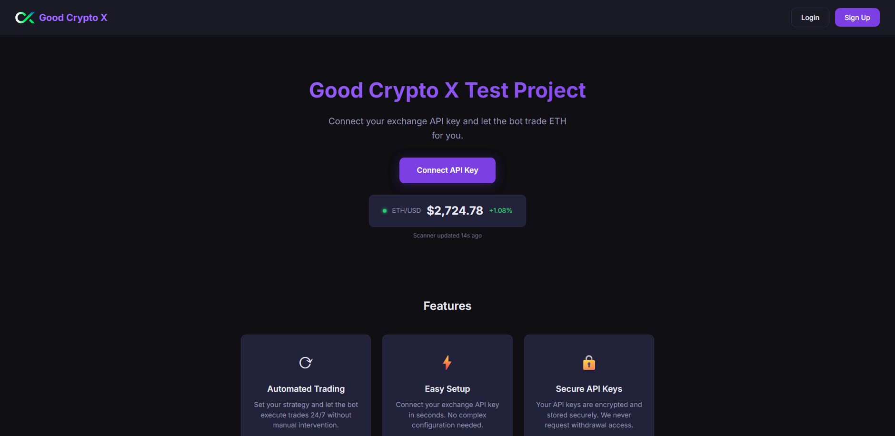

<p align="center">
  
</p>

# Good Crypto X Test Project

An Ethereum trading web app built with the MERN stack. Users connect an exchange API key, follow the live ETH/USD price, place buy and sell orders, and set price alerts.



## Features

- User sign-up and login with JWT authentication
- Exchange API keys stored with the secret encrypted, with a live connection check through [ccxt](https://github.com/ccxt/ccxt)
- Live ETH/USD price from CoinGecko, refreshed every 30 seconds
- Dashboard with ETH and USDT balances and the session high and low price
- Market and limit buy and sell orders, plus a list of open orders you can cancel
- Price alerts that trigger when ETH goes above or below a target price
- Dark theme UI

## Project Structure

```
/client   → React frontend (Vite)
  /src/pages        Home, Login, Signup, Dashboard, Alerts, ConnectKey
  /src/components   Navbar, Footer, PriceDisplay, FeatureCards
/server   → Express backend (JavaScript)
  /routes           auth, keys, price, trade, alerts, history
  /services         price scanner, trade engine, alerts, price history
  /models           User, ApiKey (MongoDB / Mongoose)
```

## Setup

Requires **Node.js 26** or newer (see `.nvmrc`; run `nvm use` if you use nvm).

### 1. Install dependencies

```bash
npm run install:all
```

### 2. Configure environment

Copy the example env file and fill in your values:

```bash
cp server/.env.example server/.env
```

Required variables:
- `MONGO_URI`: MongoDB connection string
- `JWT_SECRET`: secret for signing JWT tokens
- `ENCRYPTION_KEY`: key for encrypting API secrets
- `PORT`: backend port (default `5000`)

### 3. Run the app

```bash
npm run dev
```

- Frontend: http://localhost:3000
- Backend: http://localhost:5000

## API Endpoints

🔒 = requires `Authorization: Bearer <token>`

| Method | Endpoint | Description |
|--------|----------|-------------|
| POST | /api/auth/register | Create a new account |
| POST | /api/auth/login | Log in and get a JWT token |
| POST | /api/keys | 🔒 Save exchange API key |
| GET | /api/keys/status | 🔒 Check exchange API key connection |
| GET | /api/price | Current ETH/USD price and 24h change |
| GET | /api/history | Recent recorded prices (`?limit=50`) |
| GET | /api/history/stats | Session high, low, average and % change |
| GET | /api/trade/balance | 🔒 ETH and USDT balances |
| GET | /api/trade/orders | 🔒 Open orders |
| POST | /api/trade/buy | 🔒 Place a buy order (`amount`, optional `price`) |
| POST | /api/trade/sell | 🔒 Place a sell order (`amount`, optional `price`) |
| DELETE | /api/trade/orders/:orderId | 🔒 Cancel an order |
| GET | /api/alerts | 🔒 List price alerts |
| POST | /api/alerts | 🔒 Create an alert (`type`: `above` / `below`, `targetPrice`) |
| DELETE | /api/alerts/:alertId | 🔒 Remove an alert |

## Disclaimer

Crypto trading involves risk. This is not financial advice. Trade responsibly.
